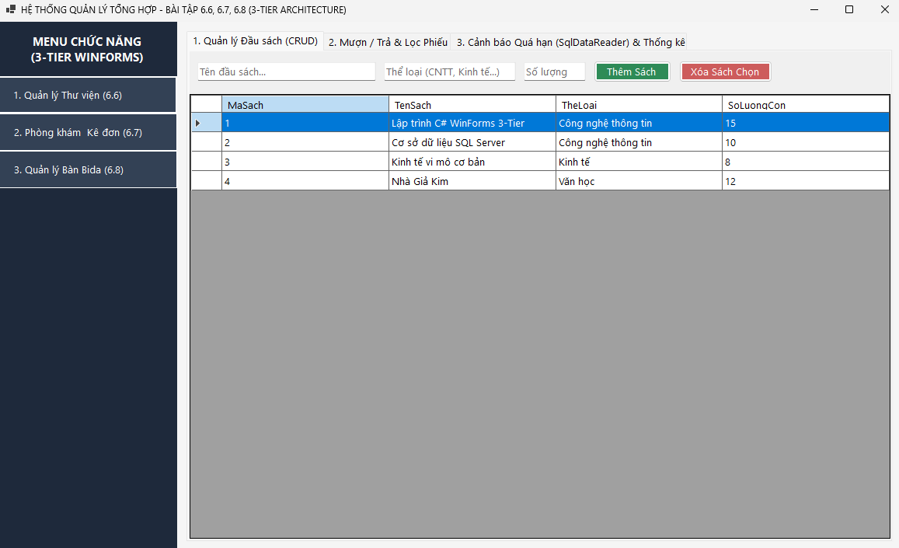
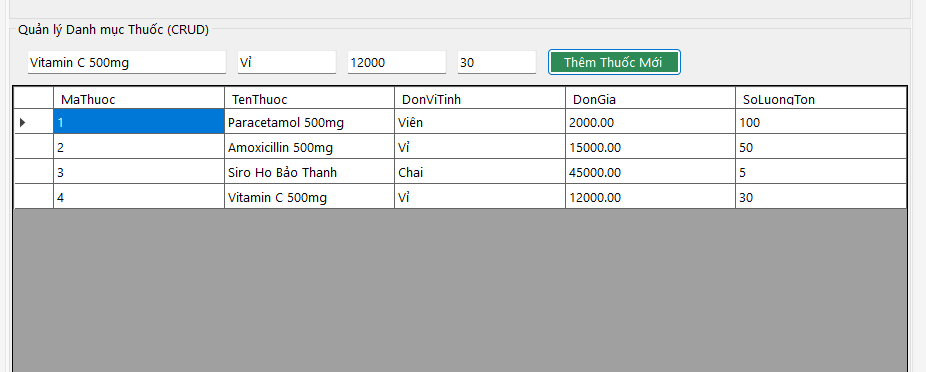
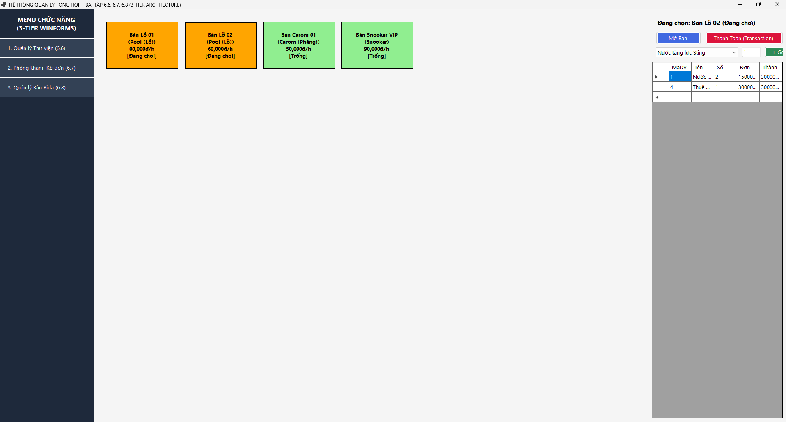
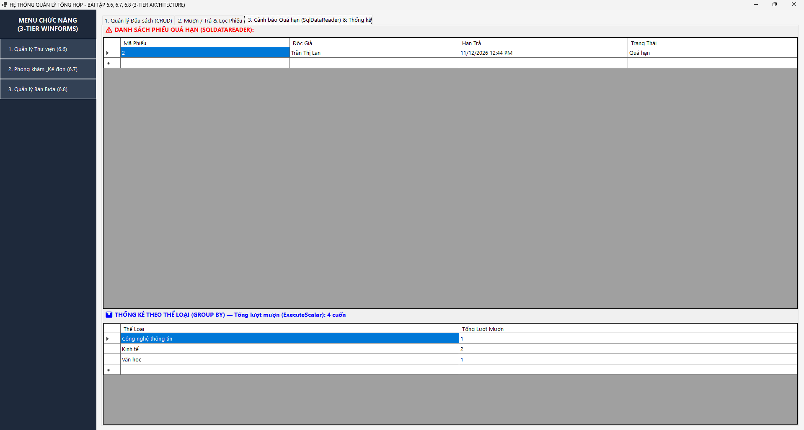
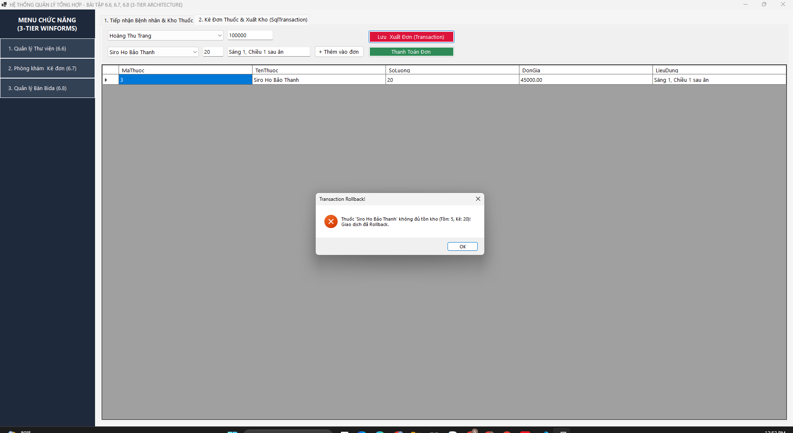

# HỆ THỐNG QUẢN LÝ TỔNG HỢP (BÀI TẬP 6.6 - 6.7 - 6.8)

## MỤC 1: THÔNG TIN SINH VIÊN

- **Họ và tên sinh viên:** Nguyễn Tiến Nhật Minh
- **Mã sinh viên:** 24810320038
- **Tên Đề tài / Bài tập:** Tích hợp 3 ứng dụng WinForms 3-Tier Architecture: Quản lý Mượn Trả Sách Thư Viện (`LibraryDB`), Quản lý Phòng Khám & Kê Đơn Thuốc (`ClinicDB`) và Quản lý Bàn Bida (`BilliardsDB`).

---

## MỤC 2: CẤU TRÚC DỰ ÁN (PROJECT STRUCTURE)

```text
baitap66_68/
├── images/                         # 5 hình ảnh minh họa các màn hình chức năng
│   ├── 01_main_screen.png
│   ├── 02_crud_screen.png
│   ├── 03_transaction_screen.png
│   ├── 04_report_screen.png
│   └── 05_error_handling.png
├── src/
│   ├── Database/ScriptDB.sql       # Script khởi tạo 3 CSDL SQL Server
│   ├── DTO/Models.cs               # Tầng đối tượng truyền dữ liệu (DTO)
│   ├── DAL/                        # Tầng truy xuất dữ liệu (DAL, SqlTransaction, SqlDataReader)
│   ├── BUS/Services.cs             # Tầng xử lý nghiệp vụ (BUS)
│   ├── GUI/FormMain.cs             # Tầng giao diện người dùng (WinForms)
│   └── Program.cs
└── README.md
```

---

## MỤC 3: HÌNH ẢNH KẾT QUẢ CÁC MÀN HÌNH CHỨC NĂNG

### 1. Màn hình chính / Tổng quan hệ thống



### 2. Màn hình Quản lý Danh mục (CRUD)



### 3. Màn hình Nghiệp vụ chính (Transaction / Bàn Bida / Kê đơn)



### 4. Màn hình Báo cáo - Thống kê & Cảnh báo quá hạn



### 5. Minh họa An toàn Dữ liệu & Xử lý Lỗi (Exception / Rollback)


